# NIO for Cyber Defense — Neural Inverse and Neural Input Optimization on Memory-Forensics Malware Detection

Term project (Cyber Security & Machine Learning). It applies the two NIO ideas from the course repository to
**CIC-MalMem-2022** (58,596 Volatility memory dumps, 55 features, 2,887 malware binaries + benign):

| Part | Question | NIO flavour |
|---|---|---|
| **A1** | How good is a memory-forensics malware detector once you stop leaking binaries across splits? Does it catch an unseen malware type? Which Volatility plugin carries the signal? | (baselines) |
| **B1** | If a defender *releases* the detector's weights, can an auditor reconstruct its training data with a learned "data primer" ([Ch10](https://github.com/rcalix1/CyberSecurityAndMachineLearning/tree/main/FirstEdition/Ch10_AIassurance/NIOdatasetPrimer))? Records or only structure? | Neural **Inverse** Optimization |
| **B3** | Do DP-SGD-style noise or weight decay reduce that leakage, and at what accuracy cost? | Neural Inverse Optimization |
| **C1** | Given the trained detector, which firewall / automated-response / alert-threshold policy minimises peak infection in an SIR malware-spread model ([Ch7](https://github.com/rcalix1/CyberSecurityAndMachineLearning/tree/main/FirstEdition/Ch7_SoftwareAssurance/NIOmalwareDynamics))? How does a weaker (novel-type or limited-telemetry) detector change it? | Neural **Input** Optimization |

The deepfake track of the original brief (A2/B2/C2) was dropped at the owner's request (see `DECISIONS.md`).
All work is defensive: building detectors, auditing what a released detector leaks, and optimising defender policies.

**Read [`RESULTS.md`](RESULTS.md)** for the numbers, [`DECISIONS.md`](DECISIONS.md) for every judgement call.

## Layout

```
src/        data_malmem.py  models.py  train.py  nio_inverse.py  nio_input.py  sir.py  leakage.py  plotting.py  utils.py
scripts/    00_sanity_reproductions.py  01_baselines_malmem.py  03_primer_malmem.py  05_primer_defense.py
            06_policy_malware.py  08_make_figures.py  09_render_results.py
results/    every number in RESULTS.md (csv / json written by the scripts)
figures/    300-dpi PNG + vector PDF
docs/       RESULTS.template.md (rendered into RESULTS.md by scripts/09_render_results.py)
```

## Reproduce

```bash
uv venv .venv --python 3.12
uv pip install --python .venv -r requirements.txt     # CUDA 12.8 PyTorch wheel; CPU-only also works
bash run_all.sh                                       # ~25-35 min on a laptop; writes results/, figures/, RESULTS.md
```

To publish: `gh auth login`, then `bash publish.sh`. It checks authorship and forbidden files, creates the private repo,
pushes, and lists contributors.

The dataset is fetched automatically with `datasets.load_dataset("bvk/CIC-MalMem-2022")` and cached in `data/`
(git-ignored). A CUDA GPU is used automatically when available (detector training, DP per-example gradients);
the tiny unrolled NIO loops run on CPU, where they are faster.

## Figure gallery

| | |
|---|---|
| 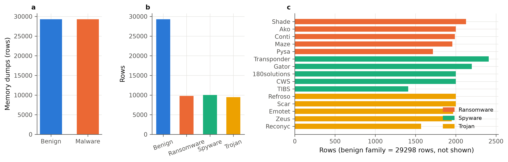 fig01 dataset | 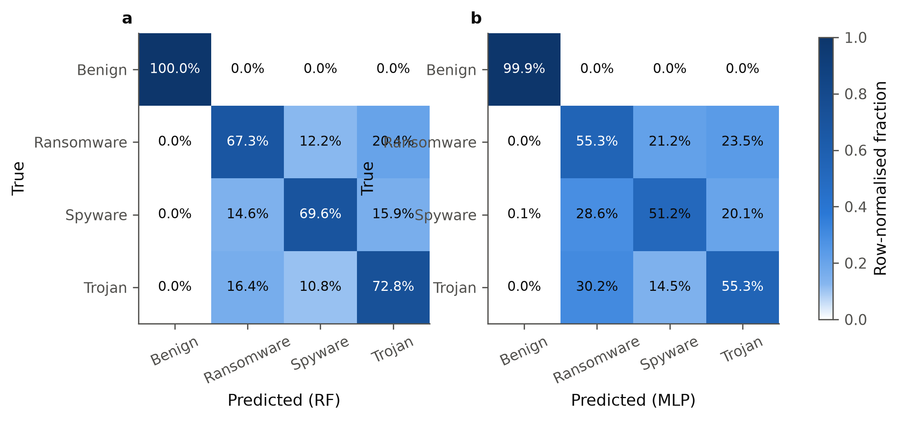 fig02 4-class confusion (group split) |
| 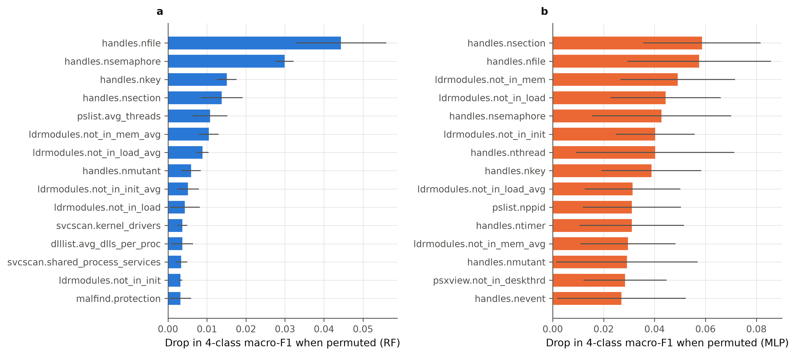 fig03 permutation importance | 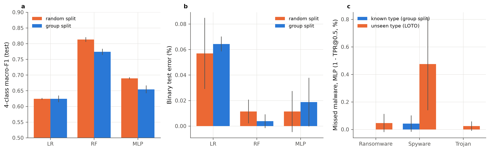 fig04 random vs group vs leave-one-type-out |
| 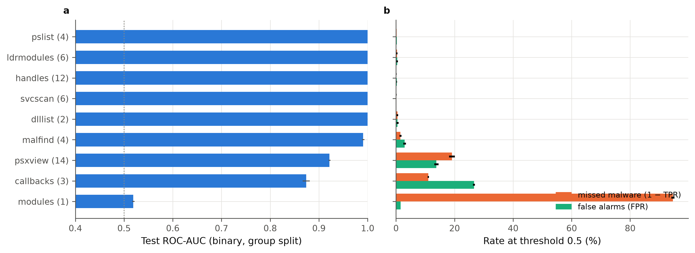 fig19 one detector per Volatility plugin | 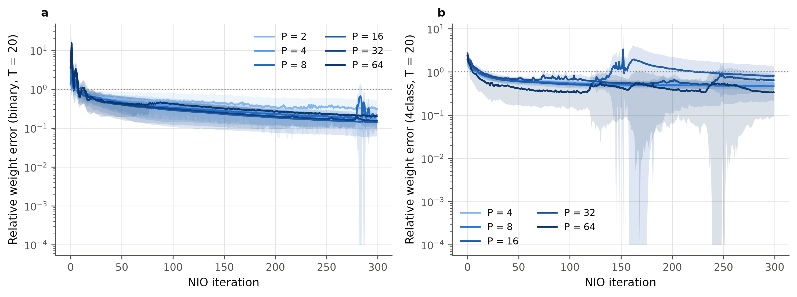 fig06 NIO convergence |
| 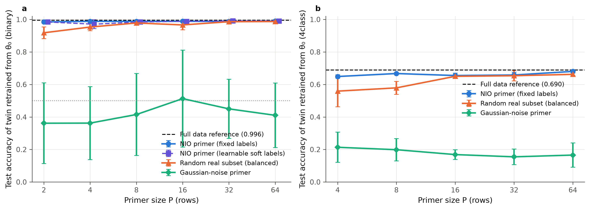 **fig07 primer vs baselines (key figure)** | 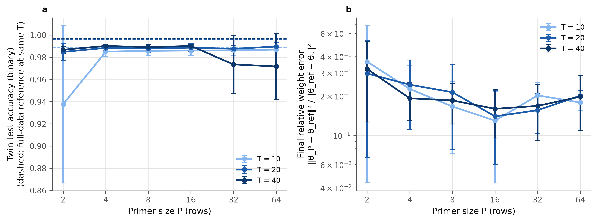 fig08 inner-step sweep |
| 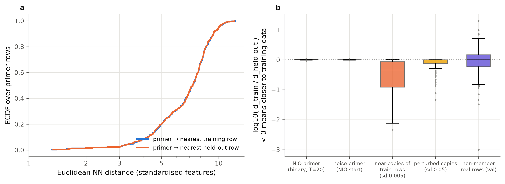 fig09 nearest-neighbour leakage test | 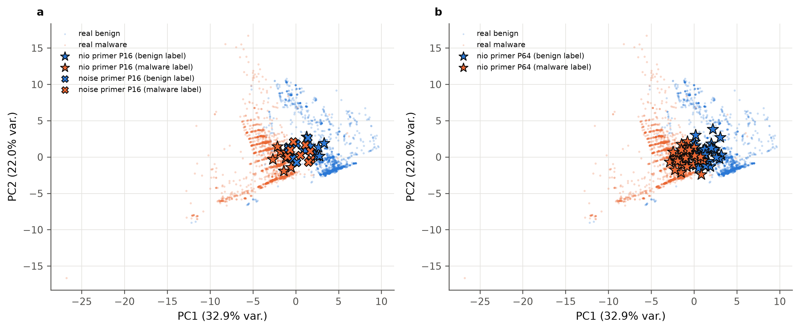 fig10 PCA with primer overlay |
| 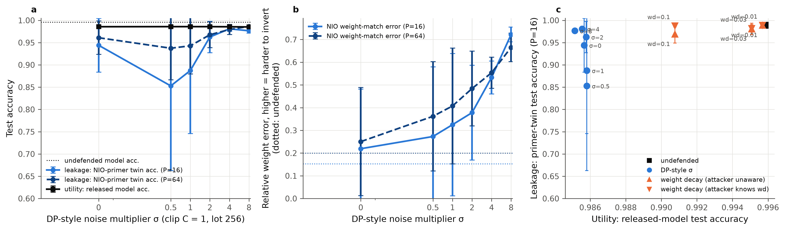 fig11 privacy / utility | 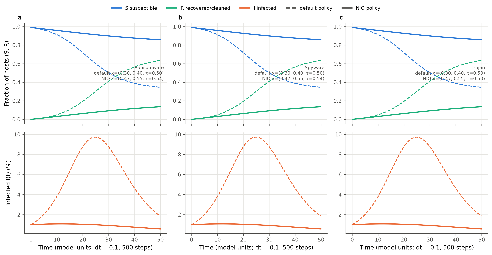 fig13 SIR default vs NIO policy |
| 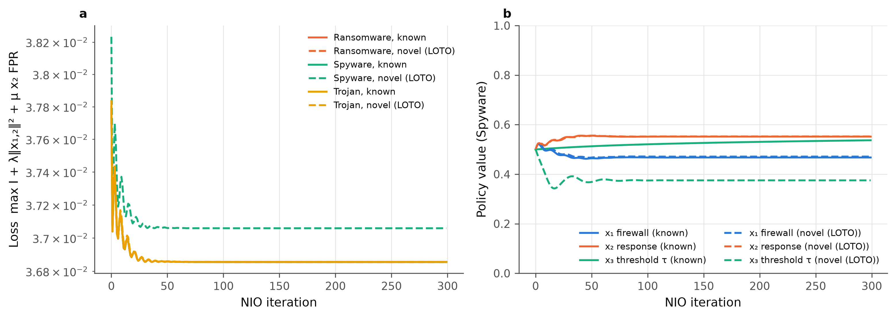 fig14 policy convergence | 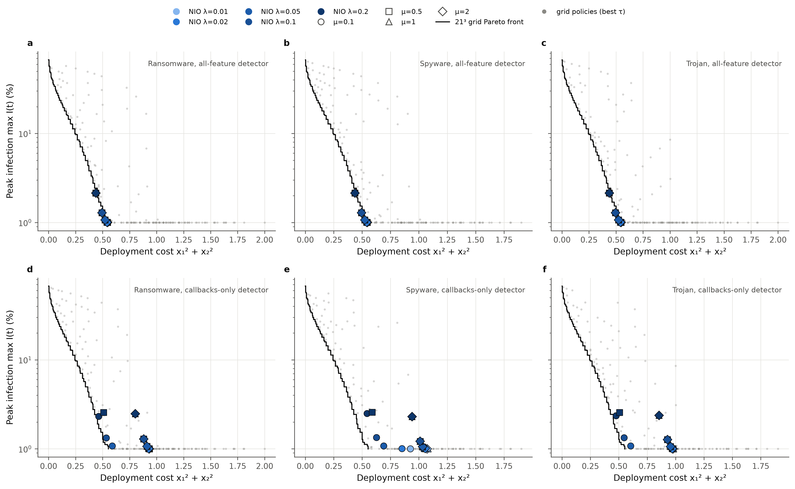 fig15 Pareto + grid verification |
| 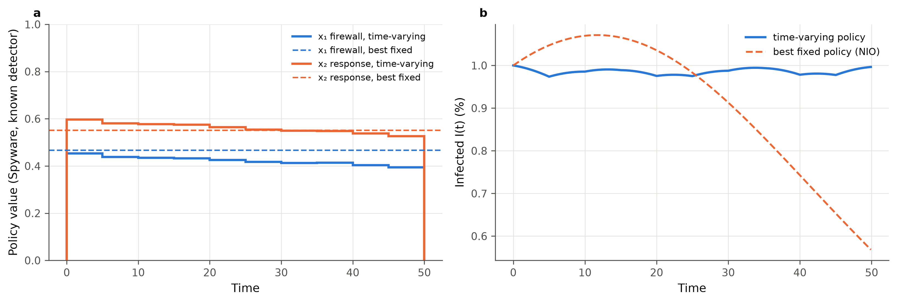 fig16 time-varying policy | 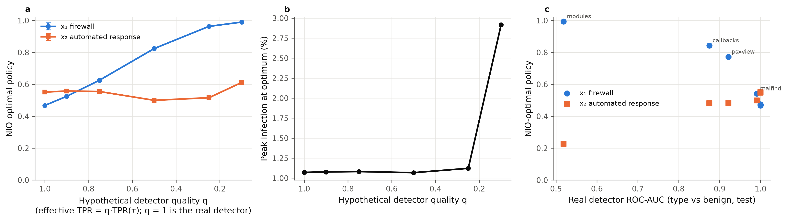 fig18 detector quality → policy |

Figure numbers 05, 12 and 17 belonged to the dropped deepfake track.
